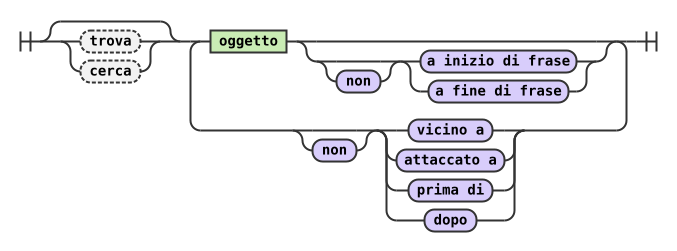
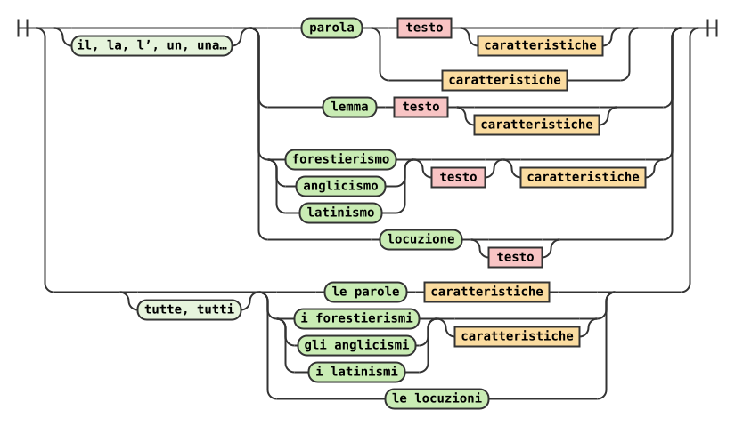
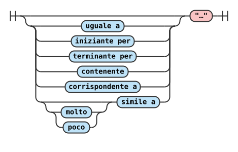
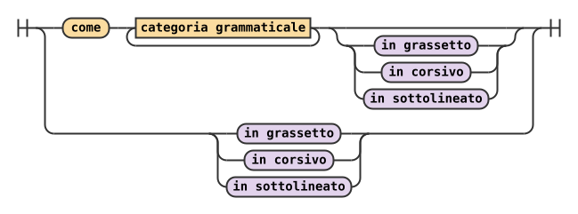

# Minerva Frontend Application

This is an Angular application (currently Angular 22), using the Pythia frontend libraries (`@myrmidon/pythia-*`). Its UI is in **Italian**: the source messages are in English, and the production build replaces them with their Italian translations (see [Localization](#localization)).

🐋 To build and publish the Docker image:

1. if you changed anything in the UI or updated the Pythia packages, update the translations as explained in [Localization](#localization). Check that the next step does not emit any `No translation found` warning.
2. update the version in `package.json`, `public/env.js` and `env.team.js` (and in Docker compose scripts).
3. build the Italian version of the app: `pnpm run build` (i.e. `ng build`, whose default configuration is `production`, localized in Italian). The output is in `dist/minerva/browser`, which is what the `Dockerfile` copies into the image.
4. (once per development machine): ensure you have a buildx builder instance running that supports multi-arch:

```sh
docker buildx create --use --name multi-arch-builder || docker buildx use multi-arch-builder
docker buildx inspect --bootstrap
```

5. build for both platforms and push directly to Docker Hub (replace the version with the current one):

```sh
docker buildx build --platform linux/amd64,linux/arm64 -t vedph2020/minerva-app:5.0.1 -t vedph2020/minerva-app:latest --push .
```

## Localization

The app uses the [Angular built-in i18n](https://angular.dev/guide/i18n): messages are marked in templates (`i18n` attributes) and in code (`$localize`), both in this app and in the Pythia libraries it uses (which are in English). At build time, Angular replaces them with their translations: the production configuration in `angular.json` is localized in Italian (`"localize": ["it"]`, with an empty `subPath`, so that the app is output directly in `dist/minerva/browser`). Translation files are in `src/i18n`:

- `messages.xlf`: the source messages (English), extracted from the code. Never edit it, as it is regenerated by extraction.
- `messages.it.xlf`: the Italian translations.

To **update translations**:

1. run `pnpm run xi18n`. This runs `ng extract-i18n`, configured in `angular.json` to use the [ng-extract-i18n-merge](https://github.com/daniel-sc/ng-extract-i18n-merge) builder: it extracts all the messages from the app and from the libraries in `node_modules` into `messages.xlf`, and merges them into `messages.it.xlf`, keeping the existing translations, adding the new messages (without a target), and removing the messages no longer used. Its log lists the added and removed messages.
2. translate the new messages in `messages.it.xlf` with Poedit or any other XLIFF editor (or directly, by adding a `<target state="translated">...</target>` element after each `<source>`). Keep the placeholders (`<x id="..."/>`) of the source in the target. To find the messages to translate, look for units without `target`, or with a target whose state is not `translated` (e.g. `new`, when the source of an already translated message has changed).
3. build (`pnpm run build`): Angular warns about any message without translation (`No translation found for ...`), which would be displayed in English.

>Library messages have numeric IDs computed from their text, so they change whenever their text changes in a new version of the libraries: so, remember to update translations after updating the Pythia packages. Messages of this app may also have custom IDs (like `@@rateLimit.message`).

**Local Italian preview** (since `ng serve` can't serve translated output): there is a `development-it` build configuration in `angular.json` (unoptimized, sourcemaps, `localize: ["it"]`), plus two scripts:

- `pnpm run watch:it` → `ng build --watch --configuration development-it`, rebuilds on save (~9s, unminified) with real Italian strings;
- `pnpm run preview:it` → static-serves `dist/minerva/browser` on port 8080 via http-server.

Run both in separate terminals, then browse <http://localhost:8080> and refresh after each rebuild. `ng serve`/`pnpm start` stays English-only and fast (HMR) for general dev work: that split is unavoidable given how Angular i18n inlining works.

## Deployment

For local deployment with database, follow these instructions according to your OS.

- **Windows**:

1. create directory:

    ```ps1
    md -Force "C:\data"
    ```

2. download ZIP (change the example URL as required):

    ```ps1
    Invoke-WebRequest -Uri "http://www.fusisoft.it/xfer/minerva-bin.zip" -OutFile "C:\data\minerva-bin.zip"
    ```

3. unzip the downloaded ZIP and remove it:

    ```ps1
    Expand-Archive -Path "C:\data\minerva-bin.zip" -DestinationPath "C:\data" -Force
    Remove-Item "C:\data\minerva-bin.zip" -Force
    ```

4. ensure your compose script has a bound volume for data:

```yml
    environment:
      # ...
      # unzip bin files from DB into host opt/dump to restore the DB
      - DATA__SOURCEDIR=/opt/dump/
    volumes:
      - type: bind
        source: 'c:/data'
        target: '/opt/dump'
```

- **Ubuntu**/**MacOS**:

1. create directory (`-p` creates parent directories if they don't exist):

    ```sh
    sudo mkdir -p /opt/dump
    ```

2. download ZIP (the `-L` option for `curl` follows redirects; the `-O` option for `wget` and `curl` specifies the output file):

    ```sh
    sudo curl -L http://www.fusisoft.it/xfer/minerva-bin.zip -o /opt/dump/minerva-bin.zip
    # OR
    sudo wget http://www.fusisoft.it/xfer/minerva-bin.zip -O /opt/dump/minerva-bin.zip
    ```

3. unzip the downloaded ZIP and remove it:

    ```sh
    sudo unzip /opt/dump/minerva-bin.zip -d /opt/dump
    sudo rm /opt/dump/minerva-bin.zip
    ```

4. ensure your compose script has a bound volume for data:

```yml
    environment:
      # ...
      # unzip bin files from DB into host opt/dump to restore the DB
      - DATA__SOURCEDIR=/opt/dump/
    volumes:
      # host:container
      - /opt/dump:/opt/dump
```

### Public and Teammates Versions

The same image provides two versions of the app, configured at runtime via `env.js`:

- **public** (default): `hideMap` is `"true"` in `env.js`. Users can read only the context of each search result; the document map is neither shown nor loaded, and the "read document" button is hidden. The map is hidden whenever `hideMap` is missing too: only an explicit `"false"` enables it.
- **teammates**: `hideMap` is `"false"`, so that users can browse whole documents via their map. `env.team.js` is the `env.js` for this version (it also points to its own API); deploy it by mounting it over the image's `env.js`:

```yml
    volumes:
      - ./env.team.js:/usr/share/nginx/html/env.js:ro
```

Hiding the map is just a UI feature: the API must also refuse to serve whole documents to the public version. So, the public API must run with `READER__ISFULLTEXTDISABLED=true` (setting `Reader:IsFullTextDisabled` in its configuration), while the teammates version needs an API with full text enabled (`READER__ISFULLTEXTDISABLED=false`, the default). The provided `docker-compose.yml` runs both versions: the public app at port 4200 with its API at 5180, and the teammates app at port 4201 with its API at 5181, both sharing the same database. Remember to keep `env.team.js` in sync with `env.js` when changing other settings.

## Static Pages

Source document: <https://docs.google.com/document/d/12yXGM6TPunSVkkMUiW7ejtkqc0GaAPr8OJZAKnUGLZg/edit?usp=sharing>

## Higher Order Query DSL

Minerva uses the [Pythia search engine](https://vedph.github.io/pythia-doc). The [Pythia query language DSL](https://vedph.github.io/pythia-doc/query.html) is very powerful, but for some audiences it might just be too much. This is the case for a part of the audience targeted by this Minerva frontend, built for the [Atti Chiari](https://attichiari.unige.it) project, which addresses not only linguists and jurists, but also a broader public of non-specialized users.

In the case of Minerva, a **new query layer** has been added on top of the existing one, acting as an alternative, "simple" query language, as opposed to the default one. This is just another DSL, targeting an Italian audience and much nearer to natural language expression.

In this DSL, users just build some predefined Italian sentences to query the corpus. Apart from the simplest, one-word query, which just corresponds to the word you want to find, Figure 1 shows the various paths which can be followed to build a sentence, from left to right.


- Figure 1 - The Minerva additional DSL

1. users can start from "trova" and then pick an object, like "parola", "locuzione", "lemma", "forestierismo", "latinismo", "anglicismo" on one branch, or "tutte le parole", "tutti i forestierismi", "tutti i latinismi", "tutti gli anglicismi" on another one. The former branch allows to specify expressions corresponding to comparison operators, like "iniziante per", "terminante per", "contenente", "corrispondente a" (for wildcard matches), or "(molto/poco) simile a" for fuzzy matches; these are then followed by the value being compared.

2. then, both branches converge in the optional "come" clause, which introduces search criteria derived from POS tagging, like noun, adjective, verb, one of its specific moods or tenses, etc.

3. optionally, this can be followed by an "in" clause, which adds search criteria related to typographic features (extracted from the original DOCX documents), like bold, italic, or underline.

4. finally, we can add a positional clause, like at sentence start or end, or near to, attached to (=near with zero distance), before, or after, which in turn can be followed by yet another expression like that introduced by "trova", in a recursive way.

In most cases, where these criteria require parameters the DSL supplies some meaningful defaults, thus hiding more complex details to the end users.

Once the query expression is complete, it gets **translated** into the standard Pythia query DSL, thus allowing users to have a glance at it if they want to learn it by example, or just customize some of its parameters.

For instance, users can just ask the system 'trova un anglicismo poco simile a "provider"' and get this Italian sentence automatically translated into a query like:

```txt
[language="eng"] AND [value%="provider:0.5"]
```

This query just looks for any word having both these properties:

- language = English;
- value similar to "provider" with a similarity threshold equal to 0.5 (in a range from 0 to 1, where 1 is equal).

The query will thus find any English word which is broadly similar to "provider". Should you just want to find any foreign word in these Italian texts, you could just replace "anglicismo" with "forestierismo", and get a slightly different query:

```txt
[language<>"ita"] AND [value%="provider:0.5"]
```

In this case, the DSL has built a query which finds any non-Italian word, as of course in this case we deal with an Italian corpus, where any non-Italian word is considered as foreign. On passage, legal acts are full of foreign words especially drawn from Latin, and this is thus a very useful feature in linguistic or juridic searches.

Speaking about Latin, this DSL also allows for searching not just a single word, but also a full phrase, as in most cases juridic texts use them in a highly formular way. This is made possible by the fact that the underlying Pythia engine deals with any span of text, representing any type of textual structure, whether it's a word, or a phrase, sentence, verse, etc. In this case, a query expression like 'trova la locuzione "pro tempore"' would thus be translated into `[$fp-lat] AND [$value="pro tempore"]`, where `$` is the prefix used for non-token spans ("structures"), `fp-lat` the name chosen during indexing for Latin foreign phrases, and `$value` the value of a structure, rather than of a token.

Any valid path along the expression tree can be exploited; so one might modify this expression like 'trova la locuzione iniziante per "pro"' to get `[$fp-lat] AND [$value^="pro"]`, or 'terminante per "tempore"' to get `[$fp-lat] AND [$value$="tempore"]`; in both cases, the only difference is the comparison operator.

Again, we could add more clauses about the relative position of the text being searched, like in 'trova la parola "invero" a inizio di frase"; this would be translated into:

```txt
[value="invero"] LALIGN(m=0) [$snt]
```

which means looking for a word whose value is equal to "invero", left-aligned with a sentence object, only when the maximum distance (`m`) from its start is 0. This will effectively find that word only when it appears at the beginning of a sentence.

Even these short sample expressions should be enough to show how they can be a powerful way for exploiting the potential of the underlying engine while preserving a very easy user experience. In fact, in Minerva this additional query layer just builds on top of the base one, as a higher-order DSL. In this case, we have a twofold translation:

1. the Italian query DSL is translated into the base query DSL.
2. the base query DSL is translated into SQL.

Alternatively, Minerva users can also use the base query DSL, either directly or from a translated expression (when they want to modify it); in both cases, we will end up with the same SQL code. Of course, a third-party software might either use these DSLs, or just bypass them and use its own, or even no DSL at all, when directly talking to the underlying database engine via SQL or some helper tool (e.g. an ORM mapping technology).

>⚙️ Technically, both DSLs are defined via ANTLR; in the case of the Pythia engine, ANTLR generates a C# parser integrated in its backend, while in the case of Minerva its additional DSL is limited to the frontend it applies to, so there ANTLR generates a Typescript parser directly leveraged in the UI.

Finally, an even more natural addition implemented in Minerva on top of this DSL is the consequence of using natural-language like expressions for it: in fact, as an alternative input method the UI leverages the browser's builtin **speech recognition** capabilities to let users just say what they want to find. In this case, the speech is converted into text, validated and integrated by the software (for instance to introduce quotes around the values being searched), and finally translated just as it had been entered by typing it. This provides an additional and very natural way for querying this index, especially fit to wider audiences.

## ANTLR

ANTLR requires JDK to generate the TS files from the G4 grammar file.

To **install JAVA**:

1. goto <https://www.oracle.com/java/technologies/downloads/>.
2. download your installer and run it.

Setting environment variables in Windows:

1. right-click on the "Start" button and select "System".
2. click on "Advanced system settings".
3. in the "Advanced" tab, click on "Environment Variables".
4. under "System variables", find the "Path" variable and click "Edit".
5. add the path to the "bin" directory of your Java installation. This is typically located in `C:\Program Files\Java\jdk-version\bin`. Click "OK" to save the changes.
6. Verify Installation from a PowerShell terminal with command `java -version`:

To **generate code from G4** grammar files in Ubuntu:

```bash
python3 -m venv pyantlr
cd pyantlr
source bin/activate
pip install antlr4-tools
antlr4 -Dlanguage=TypeScript pqita.g4
```

The [ANTLR runtime for TS](https://github.com/antlr/antlr4/blob/master/doc/typescript-target.md) is installed via `npm i antlr4`.

If you update the grammar, regenerate the TS files (from `src`: `antlr4 -v 4.13.2 -Dlanguage=TypeScript pqita.g4`) and then, in `src/app/services`:

- for lexer: overwrite `pqita.lexer.ts` and rename `pqitaLexer` in `PqitaLexer`.
- for parser: overwrite `pqita.parser.ts`, rename `pqitaParser` in `PqitaParser`, and import the listener from `./pqita.listener.js`.
- for listener: overwrite `pqita.listener.ts`, rename `pqitaListener` in `PqitaListener`, and import the parser from `./pqita.parser.js`. The listener is pure generated code: the translation logic is in `pqita.translator.ts`, which walks the parse tree.

Then update the translator, the token descriptions used for hints (`TOKEN_INFOS` in `pqita.service.ts`), the syntax diagrams (see below), and the user manual. The manual spec checks that each example in the manual tables is translated as shown there.

### Grammar

The ANTLR grammar converts fixed but composable Italian sentences into Pythia queries. It is a subset of the Pythia query language: every sentence maps to a valid Pythia query.

💡 To test the grammar with the online [ANTLR Lab](http://lab.antlr.org):

1. remove the default code you find in both Lexer and Parser.
2. in Parser, paste the whole content of the [grammar file](src/pqita.g4).
3. to the right, under Start rule, type `expression`.
4. enter some test query in `input` and click `Run`.

The grammar components in their order are (the asterisk marks required components):

(1) VERB: "trova" | "cerca".

(*2) SUBJECT, either:

- (2.1) ITEM, with an optional article ("il", "lo", "la", "l'", "un", "uno", "una", "un'"):
  - "parola" + (VALUE + FEATURES? | FEATURES);
  - "lemma" + VALUE + FEATURES?;
  - "forestierismo" | "anglicismo" | "latinismo" + VALUE? + FEATURES?;
  - "locuzione" + VALUE?.
- (2.2) SET, with an optional quantifier ("tutti", "tutte") and plural article ("i", "gli", "le"):
  - "parole" + FEATURES;
  - "forestierismi" | "anglicismi" | "latinismi" + FEATURES?;
  - "locuzioni".

where:

- VALUE: an optional OPERATOR ("uguale a", "iniziante per|con", "terminante per|con|in", "contenente", "corrispondente a", "(molto|poco)? simile a") + any text between double quotes.
- FEATURES: "come" + one or more POS ("verbo", "aggettivo", "plurale", ...) + optional STYLE; or just STYLE.
- STYLE: "in grassetto|corsivo|sottolineato".

(3) LOC (optional): "non"? + "a inizio di frase" | "a fine di frase" (also "all'inizio della frase", "alla fine della frase", etc.).

(4) REL (optional): "non"? + "vicino a" | "attaccato a" | "prima di" | "dopo" (with articulated prepositions like "vicino alla", "prima del", etc.) + a second SUBJECT, followed by its own optional LOC and REL, recursively.

A LOC or REL always refers to the SUBJECT preceding it.

These are the syntax diagrams shown in the manual:









They are generated by [tools/pqita-diagrams.js](tools/pqita-diagrams.js): see its header for its usage.

The lexer also has some error tokens (`UNCLOSED_VALUE`, `UNKNOWN`, `ERROR_CHAR`) which are never accepted by the parser: this turns lexical errors into syntax errors, so that users can be told what was expected. The service probes the parser with a sample of each token type to find which ones can follow the text being typed.

A text without spaces is not parsed, but searched as a single word: e.g. `cane` becomes `[value="cane"]`.

The translation builds pairs joined by `AND` for each subject:

- item: according to the item and operator, `[value OP "VALUE"]` for "parola", `[lemma OP "VALUE"]` for "lemma", `[language<>"ita"]`, `[language="eng"]` or `[language="lat"]` for foreign words (followed by `[value OP "VALUE"]` when there is a value), `[$fp-lat]` for "locuzione" (followed by `[$value OP "VALUE"]` when there is a value). OP is:
  - "uguale a" or nothing: `=`;
  - "iniziante per": `^=`;
  - "terminante per": `$=`;
  - "contenente": `*=`;
  - "corrispondente a": `?=`;
  - "simile a": `%=` with value `VALUE:THRESHOLD`, where THRESHOLD is 0.5 for "poco simile a", 0.8 for "simile a", 0.9 for "molto simile a".
- set: nothing for "parole" (which requires features), `[language<>"ita"]`, `[language="eng"]`, `[language="lat"]` for foreign words, `[$fp-lat]` for "locuzioni".
- features: a pair for each POS (e.g. `[pos="NOUN"]`, `[number="plur"]`, `[verbform="fin"]` for "modo definito", `[verbform<>"fin"]` for "modo indefinito"; see `posMap` in `pqita.translator.ts`); `[b="1"]`, `[i="1"]`, `[u="1"]` for styles.

When the subject is followed by a position, its pairs are wrapped in parentheses if more than one, and:

- loc: `LALIGN(m=0) [$snt]` for "a inizio di frase", `RALIGN(m=0) [$snt]` for "a fine di frase", prefixed by `NOT` when negated.
- rel: the operator followed by the pairs of the second subject (wrapped in parentheses if more than one):
  - "vicino a": `NEAR(m=3,s=snt)`;
  - "attaccato a": `NEAR(m=0,s=snt)`;
  - "prima di": `BEFORE(m=3,s=snt)`;
  - "dopo": `AFTER(m=3,s=snt)`;
  - when negated, the operator is prefixed by `NOT` (e.g. `NOT NEAR(m=3,s=snt)`).

Location operators are right-associative in Pythia, so each operand which includes more than a pair is wrapped in parentheses: e.g. `trova la parola "a" a inizio di frase vicino alla parola "b" prima della parola "c"` becomes `([value="a"] LALIGN(m=0) [$snt]) NEAR(m=3,s=snt) ([value="b"] BEFORE(m=3,s=snt) [value="c"])`.

For instance:

- `trova la parola "cane" come sostantivo in grassetto prima della parola "bello"` is translated into `([value="cane"] AND [pos="NOUN"] AND [b="1"]) BEFORE(m=3,s=snt) [value="bello"]`.
- `trova forestierismo vicino a forestierismo` is translated into `[language<>"ita"] NEAR(m=3,s=snt) [language<>"ita"]`.
