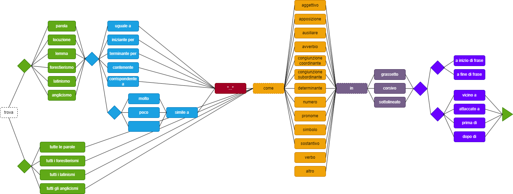

# Minerva Frontend Application

This project was generated with [Angular CLI](https://github.com/angular/angular-cli) version 18.2.8.

🐋 Docker:

1. if you changed anything, run `npm run xi18n` to extract the messages and merge them with the existing translations if any. Then use Poedit or any other tool to add translations;
2. update version in `env.js` (and in Docker compose scripts);
3. `ng build --configuration=production`;
4. `docker build . -t vedph2020/minerva-app:2.0.0 -t vedph2020/minerva-app:latest` (replace with the current version).

>Note that the default production language for Minerva images is Italian.

## Localization

To update messages: `npm run xi18n` and use Poedit to edit `messages.it.xlf`.

## Deployment

For local deployment with database, follow these instructions according to your OS.

- **Windows**:

1. create directory:

    ```ps1
    md -Force "C:\data"
    ```

2. download ZIP:

    ```ps1
    Invoke-WebRequest -Uri "http://www.fusisoft.it/xfer/minerva-bin.zip" -OutFile "C:\data\minerva-bin.zip"
    ```

3. unzip the downloaded ZIP and remove it:

    ```ps1
    Expand-Archive -Path "C:\data\minerva-bin.zip" -DestinationPath "C:\data" -Force
    Remove-Item "C:\data\minerva-bin.zip" -Force
    ```

4. ensure your compose script has a bound volume for data:

```yml
    environment:
      # ...
      # unzip bin files from DB into host opt/dump to restore the DB
      - DATA__SOURCEDIR=/opt/dump/
    volumes:
      - type: bind
        source: 'c:/data'
        target: '/opt/dump'
```

- **Ubuntu**/**MacOS**:

1. create directory (`-p` creates parent directories if they don't exist):

    ```sh
    sudo mkdir -p /opt/dump
    ```

2. download ZIP (the `-L` option for `curl` follows redirects; the `-O` option for `wget` and `curl` specifies the output file):

    ```sh
    sudo curl -L http://www.fusisoft.it/xfer/minerva-bin.zip -o /opt/dump/minerva-bin.zip
    # OR
    sudo wget http://www.fusisoft.it/xfer/minerva-bin.zip -O /opt/dump/minerva-bin.zip
    ```

3. unzip the downloaded ZIP and remove it:

    ```sh
    sudo unzip /opt/dump/minerva-bin.zip -d /opt/dump
    sudo rm /opt/dump/minerva-bin.zip
    ```

4. ensure your compose script has a bound volume for data:

```yml
    environment:
      # ...
      # unzip bin files from DB into host opt/dump to restore the DB
      - DATA__SOURCEDIR=/opt/dump/
    volumes:
      # host:container
      - /opt/dump:/opt/dump
```

## Static Pages

Source document: <https://docs.google.com/document/d/12yXGM6TPunSVkkMUiW7ejtkqc0GaAPr8OJZAKnUGLZg/edit?usp=sharing>

## ANTLR

ANTLR requires JDK to generate the TS files from the G4 grammar file.

To **install JAVA**:

1. goto <https://www.oracle.com/java/technologies/downloads/>.
2. download your installer and run it.

Setting environment variables in Windows:

1. right-click on the "Start" button and select "System".
2. click on "Advanced system settings".
3. in the "Advanced" tab, click on "Environment Variables".
4. under "System variables", find the "Path" variable and click "Edit".
5. add the path to the "bin" directory of your Java installation. This is typically located in `C:\Program Files\Java\jdk-version\bin`. Click "OK" to save the changes.
6. Verify Installation from a PowerShell terminal with command `java -version`:

To **generate code from G4** grammar files in Ubuntu:

```bash
python3 -m venv pyantlr
cd pyantlr
source bin/activate
pip install antlr4-tools
antlr4 -Dlanguage=TypeScript pqita.g4
```

The [ANTLR runtime for TS](https://github.com/antlr/antlr4/blob/master/doc/typescript-target.md) is installed via `npm i antlr4`.

If you update the grammar, you should regenerate the TS files and then:

- for lexer: overwrite all the code and rename `pqitaLexer` in `PqitaLexer`.
- for parser: overwrite all the code and rename `pqitaParser` in `PqitaParser`.
- for listener: keep the existing code, patching it where required.

### Grammar

The ANTLR grammar used to convert fixed but composable Italian sentences based on components.

💡 To test the grammar with the online [ANTLR Lab](http://lab.antlr.org):

1. remove the default code you find in both Lexer and Parser.
2. in Parser, paste the whole content of the [grammar file](src/pqita.g4).
3. to the right, under Start rule, type `expression`.
4. enter some test query in `input` and click `Run`.

The grammar components in their order are  (the asterisk marks required components):

(1) VERB: "trova".

(*2):
   (2.1.) ITEM: "[la] parola" | "[la] locuzione" | "[il] lemma" | "[il] forestierismo" | "[l'] anglicismo" | "[il] latinismo".
     (2.1.1.) OPERATOR: "uguale a|iniziante per|terminante per|contenente|corrispondente a|(molto|poco) simile a" or just nothing.
     (2.1.2.) VALUE: any text between double quotes.
   (2.2.) SET: "tutte|tutti (le|i|gli)
parole|forestierismi|anglicismi|latinismi".

(3) POS: "come verbo|aggettivo|sostantivo" etc.

(4) STYLE: "in grassetto|corsivo|sottolineato".

(5.1.) LOC: ["non"] + "a inizio di frase|fine di frase".
(5.2):
   (5.2.1.) REL: ["non"] + "vicino a|(attaccato|attaccata|attaccati) a|prima (di|della|del)|dopo (di|della|del)"
   (5.2.2.) another sequence from 2 to 5, recursively.



So for instance we can have:

- `trova la parola uguale a "esempio"` which is:

1. trova
  2.1. la parola
    2.1.1. uguale a
    2.1.2. "esempio"

- `tutti i latinismi` which is:

2.2 tutti i latinismi

- `trova la parola "cane" come sostantivo in grassetto prima della parola "bello"`, which is:

1. trova
  2.1.1. la parola
  2.1.2. "cane"
3. come sostantivo
4. in grassetto
  5.2.1. prima della
  2.1. parola
    2.1.1. nothing
    2.1.2. "bello"

The corresponding parser directions are to build pairs joined by `AND`, handling recursion at branch 5.2, as follows:

- on item: according to operator:
  - "uguale a": output `[value="<VALUE>"]`;
  - "iniziante per": output `[value^="<VALUE>"]`;
  - "terminante per": output `[value$="<VALUE>"]`;
  - "contenente": output `[value*="<VALUE>"]`;
  - "corrispondente a": output `[value?="<VALUE>"]`;
  - "simile a": output `[value%="<VALUE>:<THRESHOLD>"]` where THRESHOLD is 0.5 for "poco simile a", 0.8 for "simile a", 0.9 for "molto simile a";

- on set: according to set:
  - "parole": nothing. This assumes that there will be other nodes after this (for branches 3 or 4), or we should emit an error.
  - "forestierismi": output `[language<>"ita"]`;
  - "anglicismi": output `[language="eng"]`;
  - "latinismi": output `[language="lat"]`;

- on pos: output `[pos="<POS>"]`;

- on style: according to style:
  - "in grassetto": output `[b="1"]`;
  - "in corsivo": output `[i="1"]`;
  - "in sottolineato": output `[u="1"]`;

- on loc: this provides a join between the previously output pair and the next one. According to loc:
  - "a inizio di frase":
    - if "non": output space + `LALIGN(n=1) [$name="snt"]` after a left pair. There should be one, or there is an error;
    - else: output space + `LALIGN(m=0) [$name="snt"]` after a left pair. There should be one, or there is an error;
  - "a fine di frase":
    - if "non": output space + `RALIGN(n=1) [$name="snt"]` after a left pair. There should be one, or there is an error;
    - else: output space + `RALIGN(m=0) [$name="snt"]` after a left pair. There should be one, or there is an error.

- on rel:
  - if "non", output space + `NOT`;
  - according to rel:
    - "vicino a": output space + `NEAR(m=3,s=snt)` + space;
    - "(attaccato|attaccata|attaccati) a": output space + `NEAR(m=0,s=snt)` + space;
    - "prima di|della|del": output space + `BEFORE(m=3,s=snt)` + space;
    - "dopo di|della|del": output space + `AFTER(m=3,s=snt)` + space.

## History

### 2.0.0

- 2025-06-04: ⚠️ upgraded to Angular 20.

### 1.1.0

- 2025-02-07:
  - updated Angular and packages (added feature: POS filtering).
  - added missing translations to search component.
  - better homepage style.

### 1.0.1

- 2025-01-29:
  - updated Angular and packages.
  - added view transitions.
- 2025-01-22:
  - updated Angular.
  - replaced deprecated `baseHref` with `subPath` in `angular.json`. Setting this to `""` means that the localized version will be output as the root app in the `dist/browser` folder. If we omit this, it will be output under its locale subfolder. The Dockerfile has changed accordingly.
- 2025-10-20: updated Angular.
- 2025-01-09: updated Angular and packages. 👉 Preserved direct import of `@angular/localize/init` in `app.config` to avoid runtime errors, which should not be there.
- 2024-12-29: updated packages.

### 1.0.0

- 2024-12-20:
  - ⚠️ updated Pythia dependencies to 6.
  - removed `envServiceProvider`.
  - updated Angular and packages.
- 2024-11-22: ⚠️ Upgraded to Angular 19.
- 2024-11-16: fix to "non" parsing to emit "NOT".
- 2024-11-14: fix to "non" parsing for "inizio di frase" and the like: must check for both null and undefined. This way, `parola "cane" a inizio di frase` becomes `[value="cane"] LALIGN(m=0) [$name="snt"]` while `parola "cane" non a inizio di frase` becomes `[value="cane"] LALIGN(n=1) [$name="snt"]`.

### 0.0.5

- 2024-11-07:
  - search lemma rather than word when clicking on lemma in words index.
  - better "no results" message.
  - updated Angular.
- 2024-11-06:
  - added diacritic stripping in simple query.
  - hide preset group when single.

### 0.0.4

- 2024-11-05: updated packages (fix in search clear).
- 2024-10-31:
  - updated about and Italian translations.
  - updated Angular.
  - reexported pqita.png with correct colors.
- 2024-10-30:
  - more tests.
  - added preset queries.
- 2024-10-28:
  - fix to set AND for type "tutti i latinismi in corsivo".
  - added query presets.

### 0.0.3

- 2024-10-25:
  - added many more values to "come".
  - added more tests.
  - readonly converted query in simple search.
- 2024-10-24:
  - hide query builder.
  - added single word query as a corner case in pqita service. Now if you enter a query having no inner spaces, it is assumed to be a single word search, whether the word is between `""` or not.
  - updated packages to allow hiding some controls from the word index filter and provide custom sort order entries.
- 2024-10-23: updated packages and messages.
- 2024-10-22:
  - changed some tokens in g4 (dopo without "di").
  - added tests.
  - updated Italian translations.
  - updated about page.
- 2024-10-19: hide language in word index.
- 2024-10-18:
  - added word and lemmata stats.
  - updated Angular.
  - added rate limit interceptor.

### 0.0.2

- 2024-10-18: replaced speech recognition engine to allow cross-browsers compatibility and fallback in case of no available engine (as it happens on Firefox).

### 0.0.1

- 2024-10-17: created image.
